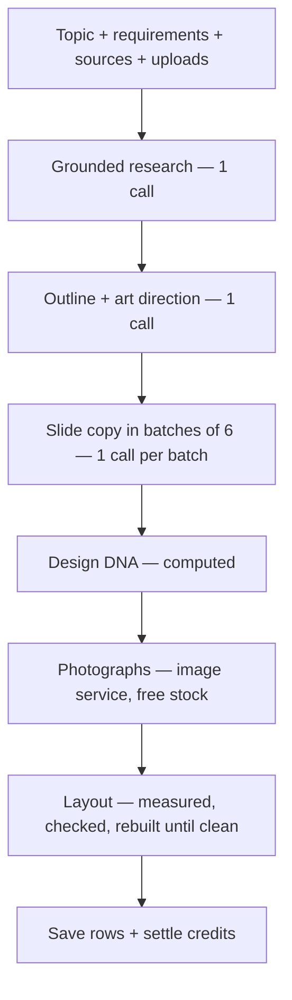

# AI generation pipeline

Generation is a staged, observable job. Every deck is designed by the **Liquid Glass engine** (`supabase/functions/_shared/glass/`); the JSLAYD design catalogue, the PowerPoint templates and the per-slide scene engine are retired and no request can reach them.

## What the model does, and what it does not

The model writes words and nothing else: an outline that names each page's *kind* (`cards`, `bullets`, `stats`, `timeline`, `process`, `comparison`, `quote`, `chart`, `statement`, `photo`) plus an art direction for the topic (light or dark, a hue, a mood, a typographic voice), then the copy for those pages. `glass/content.ts` reads any answer — missing fields, wrong kinds, charts that do not add up — into a usable page, demoting a page to the kind its content can actually fill. A failed batch is written from the outline instead; a deck is never failed over one answer.

## How a design is invented

Nothing is prepared in advance. `glass/dna.ts` turns the art direction and a seed (the presentation id) into a palette in OKLCH — a harmony of four light sources, ink and accents walked in lightness until they clear WCAG contrast on the ground *and* on a glass card — a pairing of two library typefaces suited to the mood, a corner radius and a backdrop motif. `glass/backdrop.ts` composes each page's light (radial-gradient glows) and glass objects (spheres, capsules, rings) around that page's own content. Everything is plain vector rows, so the phone, the web viewer, the PDF and the PPTX exporter draw the same thing.

### Seven styles

Every deck is set in one of seven visual languages, stored as `design_dna.style`. With "Avtomatik dizayn" on (the default) `inventDesign` takes the next style after the author's previous deck (a first deck by its seed); turned off on the create screen, the author's choice — a style and optionally a colour family (`PALETTES` in `glass/dna.ts`) — arrives as `presentations.design_request` and wins:

- **glass** — light behind translucent cards, spheres, capsules and ribbons (`glass/backdrop.ts`).
- **editorial** — the magazine page: flat paper or ink, one colour field (`colors.block`), hairline rules, square marks, photographs to the page edge. Cards are drawn as a tint, an outline or a single rule (`panelLook`); the cover, agenda, quote and closing pages have their own compositions; `glass/paper.ts` sets each page's printed marks (an edge strip, a large form cut by the page edge, a dot field or rule stack) only where they touch no content.

- **soft3d** — soft UI: one material in one near-grey colour, cards raised out of the surface and wells pressed into it (`glass/soft.ts` builds the soft shadows from stacked translucent layers, since no renderer blurs), one neon accent, and a device control per page — dial, slider, switches, grille (`glass/studio.ts`).

- **corporate** — the business template: always a white page, one brand colour (`colors.glows[0..1]`) as a large rounded gradient form bleeding off the page — a band, a great circle, a tall pill or a ring — that never touches a word set on the white, white cards floating on realistic soft shadows (`dropRows` in `glass/corporate.ts`: a tight contact shadow plus a wide ambient one, each from stacked layers), a dot grid in an open corner, the deck's mark top left, a top navigation line instead of a footer, and two-tone titles (the last line or word in the brand). The cover sets the photograph in a large rounded frame off the left edge; the closing page is one brand panel.

- **naqsh** — national ornament made modern: a white page printed on a faint girih, a band of bodom (paisley) down the right edge in the family's gradient, as wide as the page's words allow (cards may lie over it), eight-pointed stars for numbers, bullets and labels, photographs and the closing card cut to the bodom's leaf (two opposite corners swept wide). The cover lays a bodom panel down the left; the closing page is a tilework wall of girih. The ornaments are pictures in the public `design-assets` bucket under `naqsh/<family>/`, one per family and per row shape so `objectFit: cover` shows whole tiles; they are built by `supabase/scripts/build-naqsh-tiles.mjs` from the two seamless sources in `supabase/assets/naqsh/`, in the colours of `glass/naqsh-palette.ts` — the same table the deck's colours come from.
- **spektr** — an infographic deck. Its hero pages (the cover, a statement, a quotation, the close) are one vivid three-stop gradient edge to edge, the words in white in a column on the left where the gradient is deepest, what is read small (credits, chips) on white pills, and the subject's icon in Phosphor's thin line art, white and giant, standing off the right edge — as large as the words leave room for (`glass/spektr.ts`: `heroIcon`). Every other page is white, with a thin line of the whole spectrum along its foot, and on it each figure, icon, card number, timeline year and badge takes its own colour from the family's five-colour spectrum; icons sit white in a disc of their colour, titles are two-toned. Every hero stop the words cross holds white at 4.5:1 and every spectrum colour holds 4.5:1 against white both ways (tested).
- **mozaika** — the geometric (Bauhaus) deck, drawn cell by cell from the seed (`glass/mozaika.ts`): every cell a flat colour or the page, holding one figure — quarter or half disc, disc, ring, leaf, arch, drop, bow, stripes, dots, square, a burst of rays — never the same ground as its left or upper neighbour. Hero pages (cover, statement, quote, close) are a field of the family's colour (`colors.block`, the page's own background) beside a five-row block of mosaic; the cover's photograph sits in it as a disc. White pages carry one column of cells down the right edge (or the left, every other page), only where it clears everything on the page. Figures, icon discs, timeline years and badges take the spectrum, as in Spektr; set in Poppins. Every figure is a rectangle with swept corners or an ellipse: the PDF fits corners the way CSS does (one corner may sweep a whole side), and the PowerPoint export draws a shape whose corners differ as an exact SVG picture.

All five share every layout, every measurement and the same `pageFaults` check — only the drawing differs. `npm run glass:preview -- <dir> --style=editorial` photographs the editorial sample; `node supabase/scripts/deck-preview.mjs <presentationId>` photographs any real deck from the database.

### Icons

Cards, list rows and bullet rows carry an icon, and content pages may carry their subject as a large faint mark in a corner the layout left empty. The writer names an icon per point and per slide from the set in `glass/icon-set.ts` (142 Phosphor icons, generated by `supabase/scripts/build-icon-set.mjs`); a missing or unknown name is replaced by `pickIcon`, which matches the text against each icon's Uzbek and English keywords. An icon row carries its own outline (`content.vector`) and is filled per style — a two-tone gradient on glass, flat in print, the accent with a shadow on soft 3D, the brand gradient on corporate — so the phone, the web viewer, the PDF and the PowerPoint file draw the same glyph. The icon field in the writer's schema is a plain string: Gemini rejects a 142-value enum outright.

## Why nothing overlaps

`glass/metrics.ts` holds every face's real advance widths, generated from the font files by `supabase/scripts/glass-metrics.py`. `glass/text.ts` wraps copy exactly where the renderers will; `glass/compose.ts` sizes cards to what they hold and gives siblings one type size. Each finished page is checked by `pageFaults` (words on words, words off the slide, words out of their card, words over a photo) and rebuilt smaller, then as a plainer composition, until it is clean. `supabase/tests/glass-engine.test.mjs` holds this across 160 hostile decks.

`npm run glass:preview` composes a sample deck under several directions and photographs it with headless Chrome, for reviewing the design without generating anything.

## Cost

A ten-slide deck is three model calls (research, outline, copy) on the writing model configured by `GEMINI_WRITING_MODEL`; photographs come from free stock providers through `image-resolution-service`. Each call is priced from `ai.provider_pricing` into `ai_usage`, and the deck's total into `presentations.generation_cost_usd`; the admin's *Liquid Glass dizayn* page shows the average against the premium plan's price.

## Uploaded source privacy

User uploads stay in private Storage and are passed to the model only as context for that deck. Provider keys and service-role access exist only in the Edge runtime.

## Mock and production modes

Mock generation is enabled only when the server environment explicitly sets `GENERATION_MODE=mock`; it exercises the whole path with fixed copy. `GENERATION_MODE=real` fails safely when `GEMINI_API_KEY` is absent.

## O‘yingoh question generation

`generate-game` is a single structured call rather than a staged job: a quiz is
small enough to write at once, and the editor — not a progress bar — is where the
value is added. One flat JSON schema covers every authorable type, and a mapper
turns each row into the per-type `config` the grader understands, rejecting rows
whose fields contradict their type. `image_quiz` and `hotspot` are deliberately
absent from the schema: they need a picture the model does not have, so they are
added by hand.

Every generated question lands as an editable draft and the game as `draft`
status. There is no path that puts model output in front of a room without a
person having been able to change it.

`mode: "regenerate"` rewrites exactly one question, keyed by id, so re-rolling a
bad question costs one question rather than twenty. Both modes log to `ai_usage`
under `game_generation` / `game_question_regeneration`, which is where the admin
console reads O‘yingoh cost from, and both are rate limited per account through
`api_rate_limits`.

Games generated from a presentation pass the deck's own text as the source with
an instruction to use nothing else, which is the whole reason that flow exists:
the questions have to be about what the room just watched.
